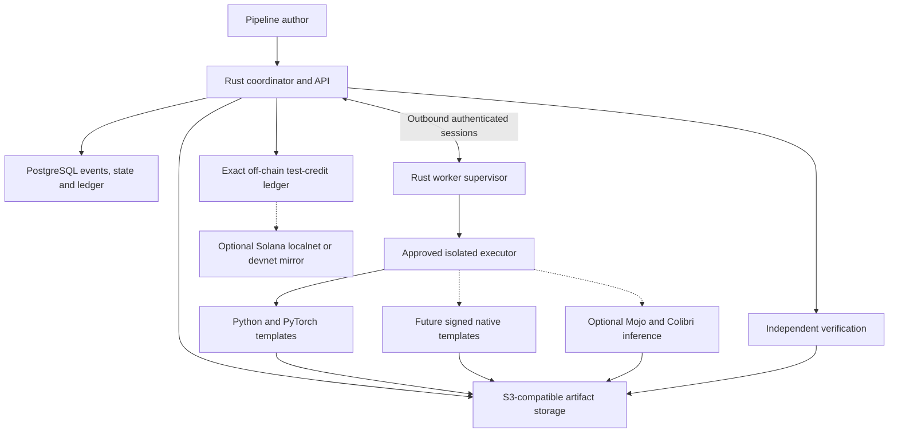

# MojoColib

[](https://github.com/kelvincushman/MojoColib/actions/workflows/ci.yml)
[](LICENSE)
[](https://coderabbit.ai)
[](#current-status)

### Verifiable AI work across ordinary machines

Rust control and trust. PyTorch training. Colibri-style NVMe model streaming.
Gated Mojo accelerator experiments. Optional Solana settlement mirroring.

> [!WARNING]
> **Research preview:** MojoColib is not yet a working compute marketplace,
> production inference service or distributed training network. The current
> repository contains protocol contracts, deterministic state machines, a
> scheduler, an in-memory simulator, structural fixtures and a pinned copy of
> the upstream Colibri engine.

## Vision

MojoColib explores a practical question:

> Can useful AI inference, fine-tuning and evaluation be scheduled across
> heterogeneous consumer hardware without pretending that residential
> machines form one low-latency supercomputer?

The project combines five ideas:

1. **NVMe-backed inference:** keep frequently used model state resident while
   streaming sparse Mixture-of-Experts weights from local storage.
2. **Checkpointable training:** split useful ML work into independent trials
   and recoverable stages that can move between compatible providers.
3. **Peer-provided compute:** allow modest gaming PCs, workstations and older
   accelerators to accept jobs they can prove they are able to run.
4. **A runtime-neutral trust plane:** use Rust contracts, signed manifests,
   fenced leases and exact accounting without making one accelerator runtime
   own the network.
5. **Portable kernel research:** evaluate Mojo where it provides a measured
   portability or performance advantage across supported hardware.

MojoColib is designed around evidence: immutable revisions, declared hardware
and runtime versions, independent evaluation, reproducible failure reports and
power-aware economics.

## Important correction: RAM is not VRAM

The imported [JustVugg/colibri](https://github.com/JustVugg/colibri) project
demonstrates GLM-5.2, a very large sparse MoE model, on a consumer machine by
combining system RAM with hundreds of gigabytes of NVMe storage.

This is **not** a claim that GLM-5.2 fits into 24 GB of GPU VRAM.

Colibri keeps dense state resident and streams routed experts from disk. Its
optional CUDA tier can accelerate selected tensors, but the core approach is a
CPU/RAM/NVMe memory hierarchy. Upstream reports a quantized model footprint of
roughly 370 GB and warns that cold decoding is storage-intensive and slow.

MojoColib has not independently reproduced or improved those figures. Read the
pinned [upstream engine documentation](engine/colibri/README.md) for its exact
method, requirements and caveats.

## Current status

| Area | Status | What exists |
| --- | --- | --- |
| Repository and provenance | Implemented | Pinned Colibri snapshot, licence record, ADRs and CI |
| Protocol contracts | Implemented | Versioned pipeline, lease, artifact, capability, benchmark, verification, audit, signing and ledger types |
| State machines | Implemented | Pure replay-safe pipeline, stage and off-chain-ledger reducers |
| Scheduler | Implemented | Deterministic compatibility, availability, reliability, resource and budget filtering |
| Simulator | Partial | One in-memory happy path; no real worker or training process |
| Tiny training fixture | Partial | Deterministic offline inputs and structural checks; executable train/resume golden pending |
| Colibri integration | Partial | Imported and CPU build-tested; not connected to a marketplace executor |
| Coordinator and worker services | Not started | No PostgreSQL, object-store or networked worker implementation |
| P2P inference and training | Not started | Protocol and product design only |
| Mojo backend | Not started | No Mojo source, compiler or runtime is required by the current build |
| Solana integration | Not started | Gated until off-chain accounting is proven |
| Public source licence | Implemented | Apache-2.0 for project-authored work; third-party terms retained separately |

The exact implemented Rust surface is listed in the
[V1 protocol inventory](docs/protocol-contracts-v1.md).

## What “P2P” means here

MojoColib initially uses **peer-provided compute coordinated through a trusted
control plane**. The scheduler can become progressively decentralised after
job execution, verification and provider economics are proven.

The first MVP does not mean:

- peer-to-peer tensor or gradient exchange;
- synchronous DDP, FSDP or tensor parallelism across household internet links;
- arbitrary anonymous providers;
- splitting every token across unreliable machines; or
- allowing customer-supplied shell commands on provider computers.

The trusted pilot uses invited providers, approved templates and outbound
authenticated worker sessions. Work is distributed at complete inference,
pipeline-stage, checkpoint or independent-training-trial boundaries.

## P2P inference direction

A future provider worker will:

1. publish a signed hardware and runtime capability record;
2. pass a versioned admission benchmark;
3. receive a bounded job with immutable model and policy references;
4. execute using an approved backend;
5. upload content-addressed results and provenance;
6. pass output validation or independent re-execution; and
7. receive test credit only for accepted work.

Colibri's local NVMe streaming is relevant because the large model cache stays
with the provider. The initial design does not stream layers between homes for
every generated token.

Planned inference backends are:

- the imported Colibri C/CPU path;
- Colibri's opt-in CUDA tier where the provider supplies compatible NVIDIA
  software;
- measured Mojo kernels on officially supported Apple, NVIDIA or AMD targets;
  and
- established CPU/vendor backends used as correctness references.

## P2P training direction

The core training experiment is not foundation-model pretraining. It is one
reproducible eight-trial LoRA sweep:

```text
prepare a pinned public dataset
  -> run eight independent LoRA trials
  -> checkpoint every trial
  -> interrupt and reassign selected trials
  -> evaluate every output under one versioned policy
  -> verify the winner on a different provider
  -> publish the accepted adapter and provenance
  -> reconcile test credits exactly
```

This workload fits heterogeneous machines because trials run independently.
Checkpoints move only when recovery or reassignment requires it.

The correctness baseline is Python, PyTorch and PEFT/LoRA. Mojo, Burn or Candle
do not replace that baseline until they pass the same fixture, interruption,
checkpoint, evaluation and hardware tests.

## Why Mojo?

Mojo is being evaluated as a future kernel and inference layer—not as the
scheduler, trust system or complete training framework.

The hypothesis is that shared Mojo source can reduce duplicated vendor-specific
kernel work across hardware targets that Modular officially supports. Every
kernel still needs target-specific compilation, correctness comparison,
profiling and tuning.

Mojo does **not** remove the need for vendor drivers or hardware runtimes.
Portable source does not imply one universal binary, support for every old GPU,
or identical performance on Apple, NVIDIA and AMD hardware.

No Mojo compiler/runtime or Modular SDK is bundled. MojoColib uses a
source-first, bring-your-own-runtime policy:

- users obtain Modular tooling from official channels and accept its terms;
- compiler, runtime, driver and accelerator versions are pinned;
- a compiled Mojo artefact is not assumed to be redistributable;
- Mojo failure disables only the optional extension; and
- the C/CPU and PyTorch reference paths remain usable.

Read the [runtime distribution policy](docs/third-party-runtime-policy.md) and
[licensing ADR](docs/adr/0009-licensing-posture.md) before publishing a
Mojo-enabled binary.

## Older GPUs and multi-GPU providers

MojoColib admits hardware by evidence, not product name. A Tesla P40, T4,
consumer GPU or Apple system must pass the exact fixture for the job template.
Unsupported instructions, insufficient memory, driver incompatibility or poor
economics make that worker ineligible for that job without excluding it from
smaller jobs.

Four GPUs do not automatically become one large VRAM pool. The MVP can schedule
four independent jobs on four cards. Provider-local tensor, pipeline or data
parallel execution is a later backend capability and must declare its topology,
interconnect and measured behavior.

## NVMe storage

Fast local NVMe is useful for model caches, checkpoint recovery, datasets and
content-addressed artifacts. A 40 Gbit/s USB4 enclosure can be valuable, but
interface speed is not sustained application throughput and NVMe is not a
replacement for VRAM.

The 500 GB development drive class is sufficient for the tiny fixtures, small
open models and early checkpoint tests. A roughly 370 GB Colibri model cache
would leave little working space, so large-model experiments need careful cache
and free-space management.

## Target architecture

The following is the intended system, not the current implementation:



Rust does not perform backpropagation. Python does not own provider identity,
scheduling or settlement. Mojo does not own the pipeline. Solana does not
decide whether computation is valid.

## Security model

Implemented at contract or reducer level:

- RFC 8785 canonical JSON commitments;
- Ed25519 envelopes bound to registry identities;
- strict rejection of duplicate JSON keys, unknown fields, floats and trailing
  data at signed trust boundaries;
- validated path-safe identifiers;
- bounded DAG depth, stage count and resource declarations;
- renewable leases with monotonic fencing tokens;
- content-addressed artifact and checkpoint manifests;
- replay-identifiable events and deterministic state reconstruction; and
- checked integer quotes, reservations and settlements.

Planned runtime controls include rootless Linux isolation, restricted dedicated
macOS accounts, default-denied network egress, short-lived object-store access,
atomic checkpoint promotion and producer/verifier separation.

The MVP prohibits personal, health, payment-card, export-controlled and other
regulated training data. It does not claim confidential-computing protection.
Read the [threat model](docs/threat-model.md) before treating any component as a
security boundary.

## Solana and settlement

The authoritative MVP ledger is an exact, replayable, off-chain test-credit
ledger. Solana is a later optional mirror:

- localnet before devnet;
- only already-final off-chain settlements are mirrored;
- chain availability never determines artifact acceptance;
- no mainnet during the MVP;
- no token issuance; and
- no real-value payments.

This ordering prevents a blockchain demonstration from hiding accounting or
verification bugs.

## Quick start

### Prerequisites

The current checks require:

- Rust 1.97 through `rustup`;
- Python 3.12 or later;
- a C compiler and `make`; and
- no model download, Mojo installation, CUDA toolkit or Solana toolchain.

```sh
git clone https://github.com/kelvincushman/MojoColib.git
cd MojoColib
make check
```

Run the in-memory simulator:

```sh
cargo run -q -p colibri-simulator
```

Validate the imported Colibri CPU engine independently:

```sh
make -C engine/colibri check
```

These checks do not run real training or download GLM-5.2.

## Repository layout

```text
crates/
  protocol/       Versioned trust and wire contracts
  state-machine/  Deterministic pipeline, stage and ledger reducers
  scheduler/      Compatible-worker filtering and selection
  simulator/      In-memory contract happy path

engine/
  colibri/        Pinned upstream Colibri snapshot

fixtures/
  protocol/       Cross-language canonical JSON cases
  tiny_training/  Offline-generated synthetic model/data fixture

docs/
  adr/            Architecture decision records
  threat-model.md
  protocol-contracts-v1.md
  third-party-runtime-policy.md
```

## Roadmap

| Phase | Goal | Status |
| --- | --- | --- |
| Foundation | Provenance, licensing, ADRs, threat model, fixture and CI | Mostly implemented; real fixture training pending |
| Contract simulator | V1 contracts, reducers, scheduler and replay | Happy path implemented |
| Dataset vertical slice | Coordinator, PostgreSQL, worker session, object storage and approved data template | Planned |
| Checkpointed LoRA | PyTorch/PEFT training, atomic promotion and cross-worker resume | Planned |
| Sweep and verification | Eight-trial orchestration, ranking, fraud corpus and independent verification | Planned |
| Ledger and economics | Reconciliation, measured energy and power-adjusted provider reports | Planned |
| Trusted P2P pilot | 5–10 invited providers across multiple hardware families | Planned |
| Mojo/Colibri extension | Multi-hardware kernel and inference benchmarks | Gated |
| Solana extension | Localnet/devnet escrow mirror after exact accounting | Gated |
| Open participation | Reputation, decentralised scheduling and broader admission | Research follow-up |

See the [training and pipeline PRD](docs/mojocolib-training-prd.md) and
[implementation plan](docs/plans/mojocolib-training-mvp-plan.md).

## Limitations

- There is no running marketplace or provider network.
- The simulator does not launch a training process.
- Checkpoint/resume is specified but not yet proven by the tiny fixture.
- The imported Colibri engine is not wired into a worker executor.
- No Mojo backend has been implemented or benchmarked.
- Hardware support and performance claims require target-specific evidence.
- NVMe streaming exchanges memory capacity for storage capacity and latency.
- Cross-backend numerical equality is not assumed.
- Anonymous providers, console execution, Coral Edge TPU execution,
  confidential workloads, real payments and mainnet are out of scope for the
  trusted MVP.

## Licensing

Project-authored MojoColib source, documentation and the deterministic
synthetic fixture are licensed under the
[Apache License 2.0](LICENSE).

The imported `engine/colibri/` snapshot is also Apache-2.0 and retains its
upstream licence and provenance. Third-party tools, dependencies, models,
datasets and vendor runtimes retain their own terms.

Mojo and the Modular SDK are governed by Modular's current terms. MojoColib
does not redistribute the Mojo compiler, Modular SDK or Modular runtime. Any
future binary containing Modular components is blocked until each component
has an express redistribution grant and the release passes the documented
composition review.

Read [NOTICE](NOTICE), [third-party notices](THIRD_PARTY_NOTICES.md),
[ADR-0009](docs/adr/0009-licensing-posture.md) and the
[runtime policy](docs/third-party-runtime-policy.md). These files are
engineering controls, not legal advice.

## Trademarks and affiliation

MojoColib is an independent community research project. It is not affiliated
with, sponsored by or endorsed by Modular, JustVugg, NVIDIA, AMD, Apple, the
Solana Foundation or any referenced model/framework maintainer.

MAX® and Mojo® are trademarks of Modular, Inc. used under license. All other
trademarks belong to their respective owners.

## Contributing

The most useful early contributions are:

- deterministic training and fresh-process resume fixtures;
- strict cross-language canonical JSON cases;
- executor-isolation and checkpoint-corruption tests;
- reproducible hardware admission benchmarks;
- Colibri worker integration; and
- scoped Mojo kernels measured against CPU/vendor references.

Contributions are accepted under Apache-2.0. Read
[CONTRIBUTING.md](CONTRIBUTING.md) before opening a pull request and report
security issues through [SECURITY.md](SECURITY.md), not a public issue.

## Further reading

- [Product and training-marketplace PRD](docs/mojocolib-training-prd.md)
- [V1 protocol contracts](docs/protocol-contracts-v1.md)
- [Threat model](docs/threat-model.md)
- [Mojo/Colibri implementation plan](docs/plans/mojo-colibri-olmoe-plan.md)
- [Why I'm learning Mojo](https://kelvinlee.io/blog/why-im-learning-mojo-the-language-that-could-break-nvidias-grip-on-ai)
- [Upstream JustVugg/colibri](https://github.com/JustVugg/colibri)
